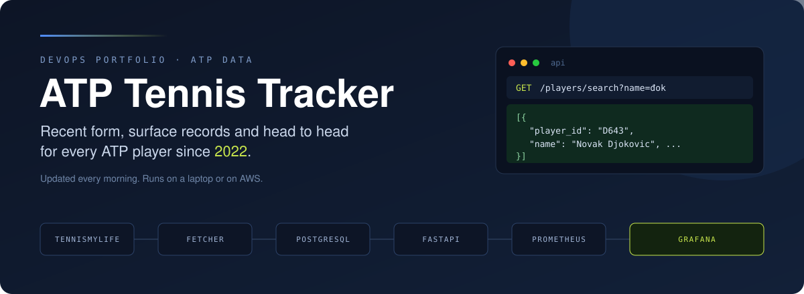
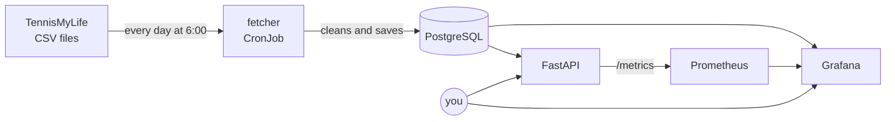

<p align="center">
  
</p>

<p align="center">
  <a href="https://github.com/acimovicluka/atp-tennis-tracker/actions/workflows/ci.yml"></a>
  
  
  
  <a href="LICENSE"></a>
</p>

<p align="center">
  <b>Collects ATP match results from 2022 onwards and turns them into player stats.</b><br>
  Search any player and see his recent form, his record on each surface, and his head to head against any opponent.
</p>

---

> The raw data only says who played who and what the score was. This project downloads it every morning, cleans it up, and works out the numbers you actually want to know before a match. I built it to learn DevOps, so the same small app runs three ways: Docker Compose on my laptop, Kubernetes on my laptop, and k3s on an AWS server that Terraform creates and Ansible sets up.

## Contents

- [What it does](#what-it-does)
- [Quick start](#quick-start)
- [The stack](#the-stack)
- [How it works](#how-it-works)
- [API endpoints](#api-endpoints)
- [CI/CD and tests](#cicd-and-tests)
- [Problems I ran into](#problems-i-ran-into)
- [Project structure](#project-structure)
- [Data and license](#data-and-license)

## What it does

Every morning a small Python script (the fetcher) downloads the latest ATP results from TennisMyLife and saves them into a PostgreSQL database. On top of that database:

- **the API** answers questions about a player: his last 10 matches, wins and losses on clay, grass and hard courts, and his head to head against anyone else
- **Grafana** shows the same stats on a dashboard, where you pick two players from a dropdown
- **Prometheus** keeps an eye on the API itself, how many requests it gets, how fast it answers and how many fail

Search works the way you'd type it, so `đok` finds Djokovic. Walkovers are left out of every stat, the same way the official ATP numbers do it.

## Quick start

| | Docker Compose | Kubernetes (Docker Desktop) | AWS (k3s) |
|---|---|---|---|
| **Good for** | quick local work | trying the Kubernetes setup | the real server |
| **Start** | `docker compose up -d` | `kubectl apply -f k8s/` | `terraform apply`, then the Deploy workflow |
| **Who fills the database** | the fetcher starts by itself | first time by hand, then every day at 6:00 | Ansible starts the fetcher at the end |
| **API** | http://localhost:8000/docs | http://localhost:18080/docs | http://&lt;ip&gt;:8000/docs |
| **Grafana** | not included | http://localhost:3000 | http://&lt;ip&gt;:3000 |
| **Stop** | `docker compose stop` | `kubectl delete -f k8s/` | `terraform destroy` |

**Docker Compose**

```bash
# copy the template and put your own password in .env
cp .env.example .env

# start the database, the fetcher and the api
docker compose up -d
```

**Kubernetes on Docker Desktop**

```bash
# copy the template and put your own password in secret.yaml
cp k8s/secret.yaml.example k8s/secret.yaml

# the database reads the schema from a configmap made from the real file
kubectl create configmap atp-schema --from-file=schema.sql

# start everything
kubectl apply -f k8s/

# fill the database the first time, after that the CronJob does it every morning
kubectl create job --from=cronjob/fetcher fetcher-first

# Docker Desktop has no load balancer, so open the api and grafana with port-forward (each in its own terminal)
kubectl port-forward service/api 18080:8000
kubectl port-forward service/grafana 3000:3000
```

**AWS**

```bash
# create the server, from the terraform folder, and note the public_ip it prints
cd terraform
terraform apply
```

Then on GitHub: Actions, Deploy, Run workflow, and paste the IP. The workflow runs the Ansible playbook, which installs k3s and starts the project. You can also run it yourself from WSL:

```bash
cd ansible
ansible-playbook -i inventory.ini playbook.yml
```

When you're done, destroy the server so it doesn't cost anything:

```bash
cd terraform
terraform destroy
```

<details>
<summary>Ports, and where to run what</summary>

| Port | What |
|---|---|
| 8000 | API |
| 3000 | Grafana |
| 9090 | Prometheus, only inside the cluster |
| 5432 | PostgreSQL, never open to the outside |
| 22 | SSH on the AWS server |

Local Kubernetes uses 18080 instead of 8000, because Windows often reserves the ports around 8000.

git, docker, kubectl and terraform run in PowerShell. Ansible runs in WSL (Ubuntu). Every command runs from the main folder of the repo, except Terraform (from `terraform/`) and Ansible (from `ansible/`).

</details>

## The stack

The project was built in six layers, and each layer added one new tool.

| Layer | Tool | What it does here |
|---|---|---|
| 1 | PostgreSQL | stores players and matches, with foreign keys so every match points to two real players |
| 1 | Python, requests | the fetcher downloads the CSV files, cleans every value and saves them |
| 2 | FastAPI | the API reads from the database and works out the stats |
| 3 | Docker, Docker Compose | one image for both the API and the fetcher, and the whole thing starts with one command |
| 4 | Terraform | creates the AWS server, the SSH key and the firewall rules, and destroys them after |
| 4 | Ansible | sets up the server: swap, git, k3s, the secret, and starts the project |
| 5 | Kubernetes, k3s | runs the database, the API and Grafana, and starts the fetcher every morning as a CronJob |
| 6 | GitHub Actions, GHCR | runs the tests on every push, builds the image and uploads it, plus a manual Deploy button |
| 6 | Prometheus | collects the API's metrics every 15 seconds |
| 6 | Grafana | two dashboards: one for players, one for the health of the API |

## How it works



The fetcher goes through one CSV file per season plus the file with tournaments that are still being played. For every tournament in a file it deletes the old matches and saves them again, all in one transaction, so the source can fix a score or renumber matches and the database always matches it. Running it twice never makes duplicates.

The API and Grafana both read from a view called `played_matches`, which is the matches table without walkovers. Prometheus asks the API for its numbers every 15 seconds, and the second Grafana dashboard shows them.

On Kubernetes the API has two health checks. `/ping` only says the API is alive, so a database problem doesn't restart it. `/ready` asks the database, so traffic only goes to the API when it can actually answer.

## API endpoints

| Endpoint | What it gives back |
|---|---|
| `/players` | every player, sorted by name |
| `/players/search?name=đok` | up to 20 players whose name matches, accents don't matter |
| `/players/D643` | one player: hand, height, country |
| `/players/D643/surface-stats` | wins and losses on each surface |
| `/players/D643/form` | the last 10 matches with the result, opponent and score |
| `/h2h/S0AG/A0E2` | head to head between two players, and every match they played |
| `/ping`, `/ready` | health checks for Kubernetes |
| `/metrics` | numbers for Prometheus |

An unknown player id gives back 404 instead of an empty list. Some ids to try: Djokovic `D643`, Sinner `S0AG`, Alcaraz `A0E2`. The full list with a "try it out" button is on `/docs`.

## CI/CD and tests

Every push to main starts the CI workflow on GitHub. It starts an empty PostgreSQL, fills it with made up test data from `tests/seed.sql`, and runs 23 tests against the fetcher and every endpoint. If a test fails, it stops there. If everything passes, it builds the Docker image and uploads it to GHCR, tagged with the commit and with `latest`.

Deploy is a separate workflow that I start by hand, because the server isn't always running. It takes the server IP, runs the Ansible playbook from GitHub, and the API restarts with the newest image. The server takes the code and the image from GitHub, never from my computer.

## Problems I ran into

| Problem | Why it happened | How I fixed it |
|---|---|---|
| The data source disappeared, twice | Sackmann's repo went 404, then the TML GitHub copy stopped in January 2026 | moved to the TML site, and the address is one variable now |
| "0 unique players processed" | ATP ids have letters (`D643`, `S0AG`) and the column was INTEGER | changed it to TEXT |
| US Open and Shanghai 2025 were missing | 489 rows have no match number, and the number is part of the primary key | the fetcher numbers them itself, always in the same order |
| The same match showed up twice | the source fixes and renumbers matches after a tournament | the fetcher deletes and saves each tournament again in one transaction |
| Walkovers counted as wins | a match that was never played was still in the stats | a `played_matches` view leaves them out (Sinner went from 289-51 to 286-46) |
| The fetcher crashed with `invalid literal for int(): 'tcp://...'` | Kubernetes adds `DB_PORT=tcp://...` by itself for a Service called `db` | `enableServiceLinks: false` |
| The API couldn't find the database in a container | `localhost` inside a container is the container itself | the database host comes from an environment variable |
| `password authentication failed` after changing `.env` | Postgres keeps the password from the very first start | `docker compose down -v` and start fresh |
| GHCR said `denied` on push | the workflow could read the repo but not write packages | Actions permissions set to read and write |
| Port 8000 was forbidden on Windows | Windows reserves a range of ports around 8000 | port-forward to 18080 locally |

## Project structure

<details>
<summary>Every file and what it does</summary>

```
ATP-tennis-tracker/
├── schema.sql              tables players and matches, and the played_matches view
├── db.py                   connect(), the one place with the database settings
├── fetcher.py              downloads the CSV files, cleans them and saves them
├── api.py                  the FastAPI endpoints, /ready and /metrics
├── requirements.txt        python packages for the app
├── requirements-dev.txt    the same plus pytest, only for the tests
├── tests/                  seed data and 23 tests for the fetcher and the api
├── Dockerfile              one image for both the api and the fetcher
├── docker-compose.yml      db, fetcher and api for local work
├── .env.example            template for .env, which holds the password
├── terraform/              the AWS server, key pair and security group
├── ansible/
│   └── playbook.yml        sets up the server and starts the project on k3s
├── k8s/
│   ├── db.yaml             PostgreSQL with its own disk
│   ├── api.yaml            the api and its load balancer
│   ├── fetcher.yaml        the daily CronJob
│   ├── prometheus.yaml     collects the api metrics
│   ├── grafana.yaml        the two dashboards
│   └── secret.yaml.example template for the database secret
└── .github/workflows/
    ├── ci.yml              tests, build and push to GHCR on every push
    └── deploy.yml          manual deploy to the AWS server
```

</details>

## Data and license

Match data comes from [TennisMyLife](https://stats.tennismylife.org/data), shared under the MIT license. This project is also MIT, see [LICENSE](LICENSE).

I built this while learning DevOps, with Claude as my mentor and pair programmer.
