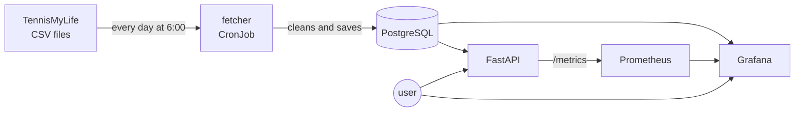

<p align="center">
  
</p>

<p align="center">
  <a href="https://github.com/acimovicluka/atp-tennis-tracker/actions/workflows/ci.yml"></a>
  
  
  
  <a href="LICENSE"></a>
</p>

<p align="center">
  <b>Collects ATP match results from 2022 onwards and turns them into player stats.</b><br>
  Search any player and see his recent form, his record on each surface, and his head to head against any opponent.
</p>

---

## Contents

- [What it does](#what-it-does)
- [Quick start](#quick-start)
- [The stack](#the-stack)
- [How it works](#how-it-works)
- [API endpoints](#api-endpoints)
- [CI/CD and tests](#cicd-and-tests)
- [Problems I ran into](#problems-i-ran-into)
- [Project structure](#project-structure)
- [Data and license](#data-and-license)

## What it does

The fetcher is a small Python script. Every morning it downloads the newest ATP results from TennisMyLife and saves them into a PostgreSQL database. Three things read from that database:

- **the API** gives stats for a player: his last 10 matches, his wins and losses on each surface, and his head to head against another player
- **Grafana** shows the same stats on a dashboard, you pick two players from a dropdown
- **Prometheus** watches the API itself: how many requests it gets, how long it takes to answer, and how many requests fail

You can search with Serbian letters too, so `đok` finds Djokovic. Walkovers don't count in any of the stats, same as in the official ATP numbers.

## Quick start

| | Docker Compose | Kubernetes (Docker Desktop) | AWS (k3s) |
|---|---|---|---|
| **Use it for** | working on the code locally | testing the Kubernetes files locally | running it on a real server |
| **Start** | `docker compose up -d` | `kubectl apply -f k8s/` | `terraform apply`, then the Deploy workflow |
| **Who fills the database** | the fetcher runs on start | you run it the first time, then it runs every day at 6:00 | Ansible runs the fetcher at the end |
| **API** | http://localhost:8000/docs | http://localhost:18080/docs | http://&lt;ip&gt;:8000/docs |
| **Grafana** | not included | http://localhost:3000 | http://&lt;ip&gt;:3000 |
| **Stop** | `docker compose stop` | `kubectl delete -f k8s/` | `terraform destroy` |

**Docker Compose**

```bash
# make your own .env from the template and put a password in it
cp .env.example .env

# start the database, the fetcher and the api
docker compose up -d
```

**Kubernetes on Docker Desktop**

```bash
# make your own secret.yaml from the template and put a password in it
cp k8s/secret.yaml.example k8s/secret.yaml

# the database gets schema.sql from this configmap
kubectl create configmap atp-schema --from-file=schema.sql

# start everything
kubectl apply -f k8s/

# fill the database the first time, after that the CronJob runs every morning
kubectl create job --from=cronjob/fetcher fetcher-first

# Docker Desktop has no load balancer, so open the api and grafana with port-forward, each one in its own terminal
kubectl port-forward service/api 18080:8000
kubectl port-forward service/grafana 3000:3000
```

**AWS**

```bash
# create the server from the terraform folder, it prints public_ip at the end
cd terraform
terraform apply
```

Then go to GitHub, Actions, Deploy, Run workflow and paste the IP. The workflow runs the Ansible playbook, and the playbook installs k3s and starts the project. You can also run the playbook from WSL:

```bash
cd ansible
ansible-playbook -i inventory.ini playbook.yml
```

When you're done, destroy the server so it doesn't cost anything:

```bash
cd terraform
terraform destroy
```

<details>
<summary>Ports, and where to run what</summary>

| Port | What |
|---|---|
| 8000 | API |
| 3000 | Grafana |
| 9090 | Prometheus, only inside the cluster |
| 5432 | PostgreSQL, never open to the outside |
| 22 | SSH on the AWS server |

Locally Kubernetes uses port 18080 instead of 8000, because Windows often reserves the ports around 8000.

git, docker, kubectl and terraform run in PowerShell, Ansible runs in WSL (Ubuntu). Run every command from the main folder of the repo, except Terraform (from `terraform/`) and Ansible (from `ansible/`).

</details>

## The stack

I built the project in six layers, and every layer added a new tool.

| Layer | Tool | What it does in this project |
|---|---|---|
| 1 | PostgreSQL | keeps the players and the matches, foreign keys make sure every match has two real players |
| 1 | Python, requests | the fetcher downloads the CSV files, cleans the values and saves them |
| 2 | FastAPI | the API reads the database and calculates the stats |
| 3 | Docker, Docker Compose | the API and the fetcher use the same image, and Compose starts everything with one command |
| 4 | Terraform | creates the AWS server, the SSH key and the firewall rules, and deletes them when I'm done |
| 4 | Ansible | sets up the server (swap, git, k3s, the secret) and starts the project |
| 5 | Kubernetes, k3s | runs the database, the API and Grafana, and starts the fetcher every morning as a CronJob |
| 6 | GitHub Actions, GHCR | runs the tests on every push, builds the image and uploads it to GHCR, and has a Deploy button |
| 6 | Prometheus | collects the API metrics every 15 seconds |
| 6 | Grafana | has two dashboards, one for the players and one for the API |

## How it works



TennisMyLife has one CSV file for every season, and one more file for tournaments that are still going on. The fetcher reads all of them. For every tournament in a file it deletes the old matches and saves them again, so when the source fixes a score or renumbers the matches, my database gets the same fix. All of that is one transaction, and running the fetcher twice doesn't make duplicates.

The API and Grafana don't read the matches table directly. They read a view called `played_matches`, which is the same table without the walkovers. Prometheus asks the API for its numbers every 15 seconds, and the second Grafana dashboard shows them.

On Kubernetes the API has two health checks. `/ping` only checks that the API is running, so if the database goes down Kubernetes doesn't restart the API. `/ready` checks the database too, and Kubernetes only sends traffic to the API when `/ready` says yes.

## API endpoints

| Endpoint | What it gives back |
|---|---|
| `/players` | all players, sorted by name |
| `/players/search?name=đok` | up to 20 players with that name, accents don't matter |
| `/players/D643` | one player: hand, height, country |
| `/players/D643/surface-stats` | wins and losses on each surface |
| `/players/D643/form` | the last 10 matches with the result, the opponent and the score |
| `/h2h/S0AG/A0E2` | head to head between two players and all their matches |
| `/ping`, `/ready` | health checks for Kubernetes |
| `/metrics` | metrics for Prometheus |

If the player id doesn't exist, the API gives back 404 and not an empty list. Some ids you can try: Djokovic `D643`, Sinner `S0AG`, Alcaraz `A0E2`. All endpoints are also on `/docs`, where you can try them in the browser.

## CI/CD and tests

When I push to main, GitHub starts the CI workflow. It starts an empty PostgreSQL, fills it with made up test data from `tests/seed.sql`, and runs 23 tests on the fetcher and on every endpoint. If one test fails, the workflow stops. If all of them pass, it builds the Docker image and uploads it to GHCR with two tags, the commit and `latest`.

Deploy is a separate workflow and I start it by hand, because the server isn't always on. It takes the server IP and runs the Ansible playbook from GitHub, and the API restarts with the newest image. The server gets the code and the image from GitHub, never from my computer.

## Problems I ran into

| Problem | Why it happened | How I fixed it |
|---|---|---|
| The data source disappeared, twice | Sackmann's repo went 404, then the TML GitHub copy stopped updating in January 2026 | moved to the TML site, the address is in one variable now |
| "0 unique players processed" | ATP ids have letters in them (`D643`, `S0AG`), and the column was INTEGER | changed the column to TEXT |
| US Open and Shanghai 2025 were missing | 489 rows have no match number, and the number is part of the primary key | the fetcher numbers them itself, always in the same order |
| The same match was saved twice | the source fixes and renumbers matches after a tournament ends | the fetcher deletes each tournament and saves it again, in one transaction |
| Walkovers counted as wins | matches that were never played were in the stats | the `played_matches` view leaves them out (Sinner went from 289-51 to 286-46) |
| The fetcher crashed with `invalid literal for int(): 'tcp://...'` | Kubernetes adds `DB_PORT=tcp://...` on its own for a Service called `db` | `enableServiceLinks: false` |
| The API couldn't reach the database inside a container | `localhost` inside a container means the container itself | the database host is an environment variable now |
| `password authentication failed` after I changed `.env` | Postgres keeps the password from the first time it started | `docker compose down -v` and start again |
| GHCR said `denied` on push | the workflow could read the repo but couldn't write packages | changed the Actions permissions to read and write |
| Port 8000 was forbidden on Windows | Windows reserves a range of ports around 8000 | port-forward to 18080 locally |

## Project structure

<details>
<summary>Every file and what it does</summary>

```
ATP-tennis-tracker/
├── schema.sql              players and matches tables, and the played_matches view
├── db.py                   connect(), the only place with the database settings
├── fetcher.py              downloads the CSV files, cleans them and saves them
├── api.py                  the FastAPI endpoints, /ready and /metrics
├── requirements.txt        python packages the app needs
├── requirements-dev.txt    the same packages plus pytest, only for the tests
├── tests/                  test data and 23 tests for the fetcher and the api
├── Dockerfile              one image for the api and the fetcher
├── docker-compose.yml      db, fetcher and api for local work
├── .env.example            template for .env, where the password goes
├── terraform/              the AWS server, the key pair and the security group
├── ansible/
│   └── playbook.yml        sets up the server and starts the project on k3s
├── k8s/
│   ├── db.yaml             PostgreSQL with its own disk
│   ├── api.yaml            the api and its load balancer
│   ├── fetcher.yaml        the CronJob that runs every day
│   ├── prometheus.yaml     collects the api metrics
│   ├── grafana.yaml        Grafana and the two dashboards
│   └── secret.yaml.example template for the database secret
└── .github/workflows/
    ├── ci.yml              tests, build and push to GHCR on every push
    └── deploy.yml          deploy to the AWS server, started by hand
```

</details>

## Data and license

The match data comes from [TennisMyLife](https://stats.tennismylife.org/data), under the MIT license. This project is MIT too, see [LICENSE](LICENSE).

I made this project while learning DevOps, with Claude as my mentor and pair programmer.
