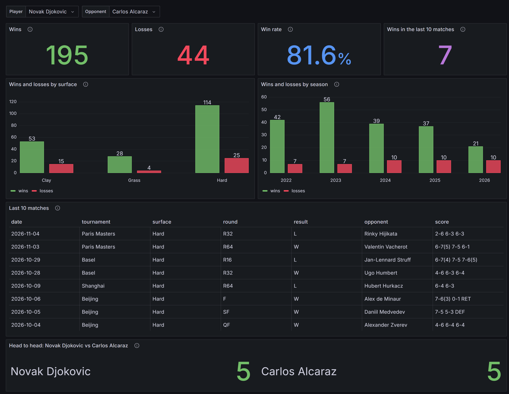
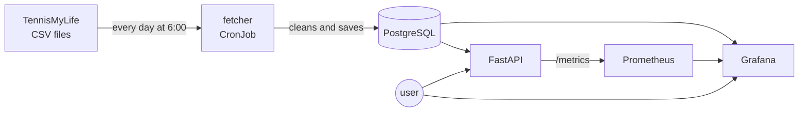

<p align="center">
  
</p>

<p align="center">
  <a href="https://github.com/acimovicluka/atp-tennis-tracker/actions/workflows/ci.yml"></a>
  
  
  
  <a href="LICENSE"></a>
</p>

<p align="center">
  <b>Collects ATP match results from 2022 onwards and turns them into player stats.</b><br>
  Search any player and see his recent form, his record on each surface, and his head to head against any opponent.
</p>

---

> You'll see the names TennisMyLife and Sackmann in this README. They are the sources of the match data. Jeff Sackmann and TennisMyLife record every ATP match and share the results as public CSV files. The links are in [Data and license](#data-and-license).

## Contents

- [What it does](#what-it-does)
- [Quick start](#quick-start)
- [The stack](#the-stack)
- [How it works](#how-it-works)
- [API endpoints](#api-endpoints)
- [CI/CD and tests](#cicd-and-tests)
- [Problems I ran into](#problems-i-ran-into)
- [Project structure](#project-structure)
- [Data and license](#data-and-license)

## What it does

ATP Tennis Tracker takes ready made CSV files with ATP results and turns them into its own database. The fetcher refreshes the database every day at a set time (on Kubernetes), so it stays up to date with the matches played that day. Once the app is running (locally or on AWS, more on that below), you get:

- **the API**, which gives stats for a player: his last 10 matches, his wins and losses on each surface, and his head to head against another player
- **Grafana**, which shows the same stats on a dashboard, where you can pick any two players from the ATP list
- **Prometheus**, which watches the API itself: how many requests it gets, how long it takes to answer, how many requests fail, and more

I made it mainly for tennis fans who want to follow player stats and compare two players, but the data can be used for other things too.


## Quick start

| | Docker Compose | Kubernetes (Docker Desktop) | AWS (k3s) |
|---|---|---|---|
| **Use it for** | working on the code locally | testing the Kubernetes files locally | running it on a real server |
| **Start** | `docker compose up -d` | `kubectl apply -f k8s/` | `terraform apply`, then the Deploy workflow |
| **Who fills the database** | the fetcher runs on start | you run it the first time, then it runs every day at 6:00 | Ansible runs the fetcher at the end |
| **API** | http://localhost:8000/docs | http://localhost:18080/docs | http://&lt;ip&gt;:8000/docs |
| **Grafana** | not included | http://localhost:3000 | http://&lt;ip&gt;:3000 |
| **Stop** | `docker compose stop` | `kubectl delete -f k8s/` | `terraform destroy` |

**Docker Compose**

```bash
# make your own .env from the template and put a password in it
cp .env.example .env

# start the database, the fetcher and the api
docker compose up -d
```

**Kubernetes on Docker Desktop**

```bash
# make your own secret.yaml from the template and put a password in it
cp k8s/secret.yaml.example k8s/secret.yaml

# the database gets schema.sql from this configmap
kubectl create configmap atp-schema --from-file=schema.sql

# start everything
kubectl apply -f k8s/

# fill the database the first time, after that the CronJob runs every morning
kubectl create job --from=cronjob/fetcher fetcher-first

# Docker Desktop has no load balancer, so open the api and grafana with port-forward, each one in its own terminal
kubectl port-forward service/api 18080:8000
kubectl port-forward service/grafana 3000:3000
```

**AWS**

Before this you need an AWS account with credentials set up for Terraform, an SSH key at `~/.ssh/atp-tracker`, and the `.env` file from above, because the playbook reads the database password from it. The Deploy button only works in my repo, since the secrets it uses are mine. In a fork you add your own `ATP_SSH_KEY` and `DB_PASSWORD` secrets, or you run Ansible from WSL.

```bash
# create the server from the terraform folder, it prints public_ip at the end
cd terraform
terraform apply
```

Then go to GitHub, Actions, Deploy, Run workflow and paste the IP. The workflow runs the Ansible playbook, and the playbook installs k3s and starts the project. You can also run the playbook from WSL:

```bash
cd ansible
ansible-playbook -i inventory.ini playbook.yml
```

When you're done, destroy the server so it doesn't cost anything:

```bash
cd terraform
terraform destroy
```

<details>
<summary>Ports, and where to run what</summary>

| Port | What |
|---|---|
| 8000 | API |
| 3000 | Grafana |
| 9090 | Prometheus, only inside the cluster |
| 5432 | PostgreSQL, never open to the outside |
| 22 | SSH on the AWS server |

Locally Kubernetes uses port 18080 instead of 8000, because Windows often reserves the ports around 8000.

git, docker, kubectl and terraform run in PowerShell, Ansible runs in WSL (Ubuntu). Run every command from the main folder of the repo, except Terraform (from `terraform/`) and Ansible (from `ansible/`).

</details>

## The stack

I built the project in six layers, and every layer added a new tool.

| Layer | Tool | What it does in this project |
|---|---|---|
| 1 | PostgreSQL | keeps the players and the matches, foreign keys make sure every match has two real players |
| 1 | Python, requests | the fetcher downloads the CSV files, cleans the values and saves them |
| 2 | FastAPI | the API reads the database and calculates the stats |
| 3 | Docker, Docker Compose | the API and the fetcher use the same image, and Compose starts everything with one command |
| 4 | Terraform | creates the AWS server, the SSH key and the firewall rules, and deletes them when I'm done |
| 4 | Ansible | sets up the server (swap, git, k3s, the secret) and starts the project |
| 5 | Kubernetes, k3s | runs the database, the API and Grafana, and starts the fetcher every morning as a CronJob |
| 6 | GitHub Actions, GHCR | runs the tests on every push, builds the image and uploads it to GHCR, and has a Deploy button |
| 6 | Prometheus | collects the API metrics every 15 seconds |
| 6 | Grafana | has two dashboards, one for the players and one for the API |

## How it works



TennisMyLife keeps one CSV file per season (2022.csv, 2023.csv and so on), plus a separate file for the tournaments that are still being played. The fetcher goes through all of them. The source sometimes fixes a score or renumbers the matches after a tournament ends, so instead of only adding new rows, the fetcher deletes every tournament it finds in the file and inserts it again. Everything runs in one transaction with a single commit at the end. If the run breaks halfway, nothing changes in the database, and running it twice in a row still doesn't make duplicates.

Neither the API nor Grafana reads the `matches` table directly. Both read from a view called `played_matches`, which is that table without the walkovers (a walkover isn't a real match, so it shouldn't count as a win). Prometheus scrapes the `/metrics` endpoint of the API every 15 seconds, and the second Grafana dashboard is built from that.

## API endpoints

| Endpoint | What it gives back |
|---|---|
| `/players` | every player in the database, sorted by name |
| `/players/search?name=đok` | up to 20 players with that name (accents are ignored, so `đok` finds Djokovic) |
| `/players/D643` | one player with his hand, height and country |
| `/players/D643/surface-stats` | wins and losses on clay, grass and hard |
| `/players/D643/form` | his last 10 matches: W or L, opponent, score |
| `/h2h/S0AG/A0E2` | the head to head score between two players, and every match they played |
| `/ping`, `/ready` | liveness and readiness probes for Kubernetes |
| `/metrics` | what Prometheus scrapes |

For an id that doesn't exist the API returns 404, not an empty list. A few ids to start with: Djokovic `D643`, Sinner `S0AG`, Alcaraz `A0E2`. FastAPI also makes a `/docs` page by itself, where every endpoint can be tried straight from the browser.

## CI/CD and tests

Every push to main starts the CI workflow in GitHub Actions. It spins up an empty PostgreSQL as a service container, loads made up test data from `tests/seed.sql` and runs 23 pytest tests, some on the fetcher's cleaning functions and the rest on every API endpoint. One failed test is enough to stop the run. When everything passes, the workflow builds the Docker image and pushes it to GHCR with two tags: the commit SHA and `latest`.

Deploy is its own workflow (`workflow_dispatch`), and I start it by hand because the server is off most of the time. I give it the server IP, it runs the Ansible playbook from GitHub, and at the end a `rollout restart` makes the API pull the newest `latest` image. The server never gets anything from my computer, the code comes from the repo and the image from GHCR.

## Problems I ran into

| Problem | Why it happened | How I fixed it |
|---|---|---|
| The data source disappeared, twice | first Sackmann's repo went 404, then the TML copy on GitHub froze in January 2026 | switched to the TML site, and the URL now lives in one variable (`BASE_URL`) |
| "0 unique players processed" | ATP ids have letters (`D643`, `S0AG`), but I made the column INTEGER | changed it to TEXT |
| Matches from the US Open and Shanghai 2025 were missing | 489 rows in 2025.csv have no `match_num`, which is part of the primary key | the fetcher numbers them itself, per tournament and in CSV order, so the numbers are always the same |
| Some matches were in the database twice | the source renumbers matches once a tournament is over | each tournament gets deleted and inserted again, inside the same transaction |
| Walkovers counted as wins | `W/O` matches were never played but were still in the stats | the `played_matches` view leaves them out (Sinner went from 289-51 to 286-46) |
| Fetcher crashed with `invalid literal for int(): 'tcp://...'` | Kubernetes injects `DB_PORT=tcp://...` for every Service named `db`, and it overwrote mine | `enableServiceLinks: false` in the pod spec |
| `/players` returned 500 inside the container | `localhost` in a container is the container itself, not my PC | `DB_HOST` comes from an env var (`db` in Compose and Kubernetes) |
| `password authentication failed` after I changed `.env` | Postgres sets the password only on the first init and keeps it in the volume | `docker compose down -v`, so it starts with a fresh volume |
| GHCR push ended with `denied` | the layers got uploaded, but the workflow token had no write access for packages | repo Settings, Actions, Workflow permissions set to read and write |
| `WinError 10013` on port 8000 | Windows (winnat) reserves a whole range of ports around 8000 | restarted winnat, and locally I port-forward to 18080 |

## Project structure

<details>
<summary>Every file and what it does</summary>

```
ATP-tennis-tracker/
├── schema.sql              tables players and matches, plus the played_matches view
├── db.py                   connect(), the only file that knows the database settings
├── fetcher.py              downloads the CSVs, cleans the values, replaces each tournament
├── api.py                  FastAPI endpoints, /ready and /metrics
├── requirements.txt        pinned python packages
├── requirements-dev.txt    requirements.txt + pytest, only for the tests
├── tests/                  seed.sql with made up data, and 23 tests
├── Dockerfile              one image, used by both the api and the fetcher
├── docker-compose.yml      db, fetcher and api for local work
├── .env.example            template for .env (the real one holds the password and stays off git)
├── terraform/              EC2 server, key pair, security group, ansible inventory
├── ansible/
│   └── playbook.yml        swap, git, k3s, the secret, then kubectl apply
├── k8s/
│   ├── db.yaml             StatefulSet for postgres with a 1Gi volume
│   ├── api.yaml            Deployment with both probes, LoadBalancer on 8000
│   ├── fetcher.yaml        CronJob, every day at 6:00 Belgrade time
│   ├── prometheus.yaml     scrapes the api, reachable only inside the cluster
│   ├── grafana.yaml        Grafana with both dashboards, LoadBalancer on 3000
│   └── secret.yaml.example template for the atp-db secret
└── .github/workflows/
    ├── ci.yml              tests, docker build, push to GHCR
    └── deploy.yml          manual deploy to AWS through Ansible
```

</details>

## Data and license

The match data comes from [TennisMyLife](https://stats.tennismylife.org/data), under the MIT license. The first version of the project used Jeff Sackmann's tennis_atp repo on GitHub, which isn't online anymore.

The whole project was built with Claude as my personal AI agent, which is why Claude is listed among the contributors and as a co-author on the commits.

This project is under the MIT license, see [LICENSE](LICENSE).
